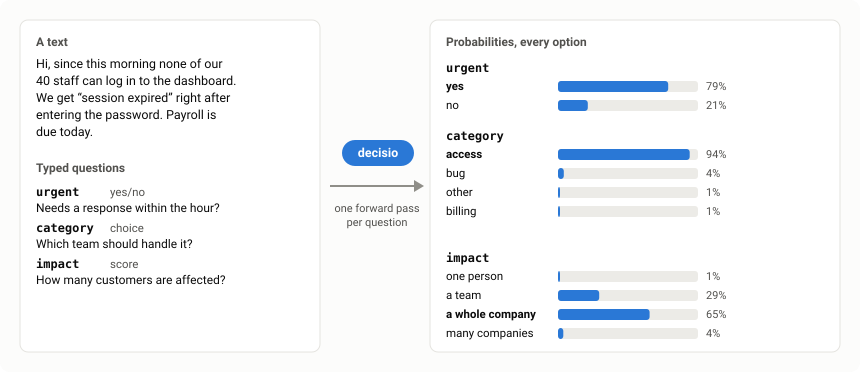
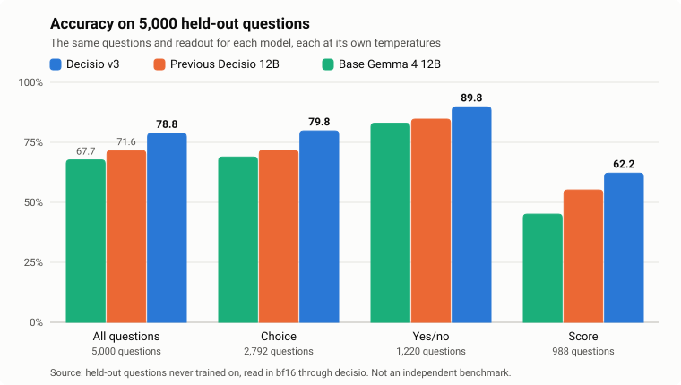
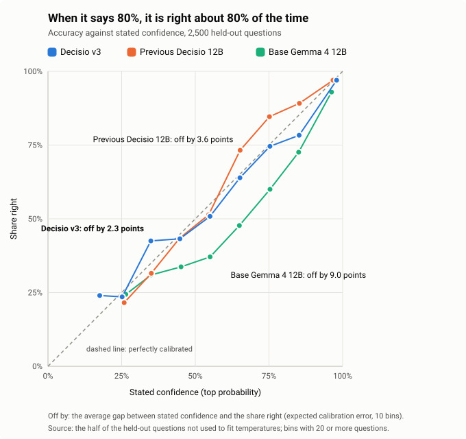

<!-- SPDX-License-Identifier: Apache-2.0 -->
<!-- SPDX-FileCopyrightText: Copyright contributors to the decisio project -->

# Decisio

**Typed questions about any text, answered with a calibrated probability for every option. Open source, on your own hardware.**

[](https://pypi.org/project/decisio/)
[](LICENSE)
[](https://github.com/aminry/decisio/actions/workflows/ci.yml)

<p align="center"></p>

Decisio is a server that reads a text and answers typed questions about it: yes or no, one choice among options, or a score on a scale you define.
Every answer is a probability for every option, read from one forward pass per question, with no text generated.
It runs open models on one NVIDIA GPU, on a Mac with Apple silicon, or through Ollama.

| | |
| --- | --- |
| **Questions** | yes/no, choice (up to 255 options), score |
| **Answer** | a probability for every option, calibrated so that 80% means right about 80% of the time |
| **Model** | Decisio v3, a Gemma 4 12B tuned for decisions, or an untrained Gemma 4 or Qwen base |
| **Runs on** | one NVIDIA GPU (vLLM), a Mac with Apple silicon (MLX), Ollama |
| **Licence** | Apache 2.0, code and weights |

## Why Decisio v3

**More accurate.** On 5,000 held-out questions it answers 78.8% right, against 67.7% for the Gemma 4 12B it is built on and 71.6% for the previous Decisio 12B.
It gains on every question type, most on scores.

<p align="center"></p>

**Calibrated.** Its stated confidence matches how often it is right: on average it is off by 2.3 points, against 9.0 for the base model.
A probability you can act on is the point of the product: a threshold you set means what it says.

<p align="center"></p>

**Fast.** One forward pass per question, with no text generated: a question about a typical text takes about 60 ms on one RTX PRO 6000 (44 ms in FP8), and about 0.9 s on a Mac.

**Exact arithmetic built in.** For bills, invoices, payslips and dates, the server adds the exact values a question depends on before the model reads the text, and shows nothing when it cannot read them with certainty ([calculator](docs/calculator.md)).

The figures are readings on held-out questions of the training distribution, never trained on, each model at its own temperatures; they are not scores on an independent benchmark.
How they were made, and more measurements, are in [docs/overview.md](docs/overview.md).

## Quick start

On a Linux machine with one NVIDIA GPU and Python 3.12:

```bash
pip install "decisio[serve]"
python -m decisio.serve.vllm_engine --base tachara-ai/Decisio-12b-tuned-v3-calibrated
curl -s http://127.0.0.1:8000/v1/systemone -H 'Content-Type: application/json' -d '{
  "state": "Hi, since this morning none of our 40 staff can log in to the dashboard. We get \"session expired\" right after entering the password. Payroll is due today.",
  "questions": {
    "urgent":   {"type": "noul", "instructions": "Does this ticket need a response within the hour?"},
    "category": {"type": "choice", "instructions": "Which team should handle this ticket?",
                 "criteria": {"billing": "Invoices, payments, refunds", "access": "Login, passwords, permissions", "bug": "The product behaves wrongly", "other": null}},
    "impact":   {"type": "score", "instructions": "How many customers does this affect?",
                 "criteria": ["one person", "a team", "a whole company", "many companies"]}
  }
}'
```

The first start downloads the model (22 GB) and the calculator's small tagger.
The same request is in [`examples/request.json`](examples/request.json) (`-d @examples/request.json` in a clone).
The answer, on one RTX PRO 6000, probabilities rounded to three decimals:

```json
{"model": "Decisio-12b-tuned-v3-calibrated",
 "answers": {
   "urgent": {"type": "noul", "noul": 0.787},
   "category": {"type": "choice", "choice": "access", "confidence": 0.921, "probabilities": {"billing": 0.008, "access": 0.941, "bug": 0.042, "other": 0.009}},
   "impact": {"type": "score", "score": 1.716, "confidence": 0.641, "legend": {"0": "one person", "1": "a team", "2": "a whole company", "3": "many companies"}, "probabilities": {"0": 0.013, "1": 0.294, "2": 0.655, "3": 0.038}}}}
```

## Pick a model

| Flavor | Use it when |
| --- | --- |
| `calibrated` | you use the probabilities themselves: thresholds, ranking, expected values |
| `commit` | you act on yes/no answers: a yes/no between 20% and 80% is reported as 20% or 80%; the answer never changes |

| Format | Repository | Size | Runs on |
| --- | --- | ---: | --- |
| bf16 | `tachara-ai/Decisio-12b-tuned-v3-calibrated` (or `-commit`) | 22 GB | NVIDIA GPU |
| FP8 | `tachara-ai/Decisio-12b-tuned-v3-fp8-calibrated` | 12 GB | NVIDIA GPU, for smaller cards |
| MLX 8-bit | `tachara-ai/Decisio-12b-tuned-v3-mlx8-calibrated` | 12 GB | Mac with Apple silicon |
| MLX 6-bit | `tachara-ai/Decisio-12b-tuned-v3-mlx-calibrated` | 9 GB | Mac with Apple silicon, 32 GB |
| Ollama | `aminroudaki/decisio-v3` (`q8_0`, `q4_k_m`) | 12.7 / 7.4 GB | any machine with Ollama |

Every repository has a `commit` twin.
Decisio v3 needs decisio 0.51.1 or later; with decisio 0.50.x, pin the revision tagged `v3-calc-v1`.

The untrained bases are one flag away, with the same routes and features: `--base gemma-4-31b` (the default, FP8, the most accurate base), `--base gemma-4-12b`, `--base qwen3.6-35b-a3b`, and the small `--base gemma-4-e4b` and `--base qwen3.5-4b` ([choosing a base](docs/overview.md#choosing-a-base)).

## Run it

**GPU (vLLM):** as in the quick start; `--base` takes any repository above.

**Mac (MLX):**

```bash
pip install "decisio[mlx]"
python -m decisio.serve.vllm_engine --backend mlx --base tachara-ai/Decisio-12b-tuned-v3-mlx8-calibrated
```

**Ollama:**

```bash
ollama pull aminroudaki/decisio-v3
```

Ollama answers the same `/v1/systemone` route with the model's own temperatures; the calculator comes only with decisio's own server ([Ollama](docs/running.md#ollama)).

**Docker:**

```bash
docker run -d --gpus all --shm-size 8g -p 127.0.0.1:8000:8000 -e DECISIO_BASE=tachara-ai/Decisio-12b-tuned-v3-calibrated -v decisio-data:/data ghcr.io/aminry/decisio@sha256:af80bd4ea309868ba52475d2d08b19258d5349e2b479c14c75d093d79ae8cd02
```

**From source** (the measured environment):

<!-- x-release-please-start-version -->
```bash
git clone --branch v0.52.0 https://github.com/aminry/decisio
cd decisio
uv sync --extra serve --frozen
uv run python -m decisio.serve.vllm_engine --base tachara-ai/Decisio-12b-tuned-v3-calibrated
```
<!-- x-release-please-end -->

## Speed and memory

| Setup | Weights | First start, with the download | One question, median / 95th percentile |
| --- | ---: | ---: | ---: |
| RTX PRO 6000, bf16 | 22 GB | 4 min 51 s | 60 / 144 ms |
| RTX PRO 6000, FP8 | 12 GB | 3 min 41 s | 44 / 97 ms |
| Mac M5 Pro (64 GB), MLX 8-bit | 12 GB | 2 min 51 s | 0.90 / 1.07 s |

One request at a time over 500 held-out texts of mixed length (100 on the Mac), decisio 0.51.0 installed with pip as above, the published repositories, the calibrated flavor.
On a GPU, vLLM reserves most of the card's memory for its cache by default; `--gpu-memory-utilization` lowers it.

## What else it does

| | | |
| --- | --- | --- |
| **Three question types**<br>yes/no, choice, score, several in one request | **Calibrated probabilities**<br>every option, every question | **One forward pass**<br>no generated text, nothing to parse |
| **Teach it your task**<br>calibration and a small head fitted on your labelled examples, kept only if they help ([tasks](docs/tasks.md)) | **Certified answers**<br>an answer marked certified when your examples say it can be trusted at your error rate | **Exact arithmetic**<br>bills, invoices, payslips, dates and times ([calculator](docs/calculator.md)) |
| **Images**<br>Gemma 4 bases read pictures, on vLLM and on a Mac ([images](docs/running.md#images-on-gemma-4---images-on)) | **System One compatible**<br>a System One client works unchanged ([API](docs/api.md)) | **Your hardware**<br>pinned revisions, no data leaves the machine |

## Limits

- Decisio v3 was trained on text; it reads images through the base's image path, unmeasured.
- The calculator covers billing amounts and dates and times; other arithmetic gets no block, and some layouts it cannot read get none.
- A certificate holds for one task on one serving setup; it is a rate over many answers, not a promise about one.
- The accuracy figures are on held-out questions of the training distribution; your questions may differ.

## Learn more

[Decisio in depth](docs/overview.md) · [API](docs/api.md) · [Running it](docs/running.md) · [Calculator](docs/calculator.md) · [Tasks](docs/tasks.md) · [Upgrading](docs/upgrading.md) · [Troubleshooting](docs/troubleshooting.md)

## Contributing and licence

Issues and pull requests are welcome ([CONTRIBUTING.md](CONTRIBUTING.md)).
Decisio is Apache 2.0; each model's weights carry their base model's licence.
